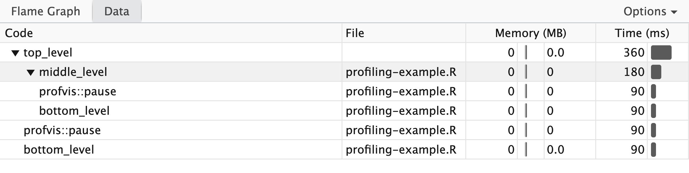
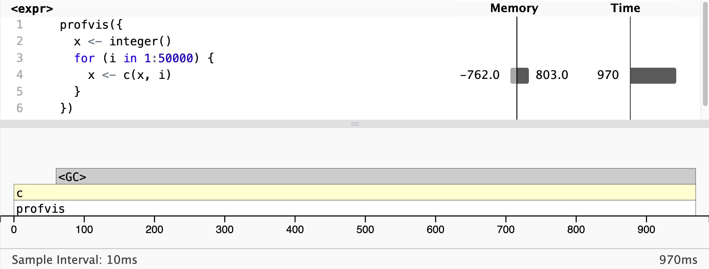

:::::::::::::::::::::::::::::::::::::: questions 

- How can the **profvis** package be used to profile an R program?
- How can the output from `profvis()` be interpreted?

::::::::::::::::::::::::::::::::::::::::::::::::

::::::::::::::::::::::::::::::::::::: objectives

- Explain how **profvis** profiles R code 
- Use **profvis** in RStudio to visualise profiling information for an R script
- Interpret **profvis** views to identify the functions where time is being spent during a script's execution
- Interpret **profvis** views to identify the functions which result in heavy memory allocation

::::::::::::::::::::::::::::::::::::::::::::::::

## Introduction

To make our code more efficient, we first need to identify the bottlenecks, in terms of time and/or memory usage.

Software is typically comprised of a hierarchy of function calls, both functions written by the developer and those used from the language’s standard library and third party packages.

We will use the [**profvis**](https://profvis.r-lib.org) package to profile code and visualise the results. **profvis** is a *sampling profiler*. It stops the execution of code every few milliseconds and records:

- The call stack: the function currently being executed, the function that it was called from and so on up to the top-level function call.
- The memory allocated and released since the last record.

::: callout
A sampling profiler makes a trade-off between accuracy and performance. 
There is always variability in the time it takes a function to run and the accuracy of the timer.
Each time you profile, you'll get a slightly different answer, though the variability is most pronounced in the functions that take the shortest amount of time to run, i.e. those that are of the least interest to us.
:::

## Example

Below are some nested functions. The `profvis::pause()` function provides a synthetic bottleneck by holding up execution of the code for the specified number of seconds.

```r
top_level <- function() {
  profvis::pause(0.1)
  middle_level()
  bottom_level()
}
middle_level <- function() {
  profvis::pause(0.1)
  bottom_level()
}
bottom_level <- function() {
  profvis::pause(0.1)
}
```

If we profile the execution of `top_level`, after 0.1 secs, we'd recordthe call stack: `"pause"`, `"top_level"`, i.e. we're in the execution of `"pause"`, which was called from `"top_level"`. After 0.2 secs, we'd record: `"pause"`, `"middle_level"`, `"top_level"`, i.e. we're in `"pause"`, as called from `"middle_level"`, which is turn was called from `"top_level"`

::::::::::::::::::::::::::::::::::::: challenge 

## Exercise 1

Continuing the example above, write down the call stack from calling `top_level()` after 0.3 secs and after 0.4 seconds.

:::::::::::::::::::::::: solution 

 
After 0.3 secs: `"pause"`, `"bottom_level"`, `"middle_level"`, `"top_level"`

After 0.4 secs: `"pause"`, `"bottom_level"`, `"top_level"`

:::::::::::::::::::::::::::::::::

::::::::::::::::::::::::::::::::::::::::::::::::

## Using profvis

:::::: callout
## Follow along

Download the <a href="files/profiling-example-1.R" download>R source for the example</a> and follow along with the worked example on your own machine. Save it into an RStudio project.

::: instructor
Demo how to create an RStudio project
:::

::::::

You should have installed the **profvis** package as part of the setup for this lesson.
In the RStudio project where you have saved the example R script, create a `profiling.R` script with the following:

```r
library(profvis)
source("profiling-example-1.R")
profvis(top_level())
```

Storing code in its own script then calling it with `source()` ensures the best connection between profiling data and source code.

### Interpretting the flame graph

An interactive HTML document will open with the results. In RStudio this will open in the source pane; click “show in new window” button to open the document in a new window. It should look something like this:


In the *flame graph* the yellow bars correspond to lines in the source file shown above the graph. 
The HTML is interactive. Hover over a bar for further details, and to see its corresponding line in the script.

In the overall time of 360ms we see:

- Four equal-sized blocks for each pause of 90ms (0.09 seconds)
- Nearly all time is spent in the top-level function
- Nearly half the time is spent in the mid-level function
- Nearly half the time is also spent in the bottom-level function

No objects are created or deleted: no memory changes.

::: callout
Note that at the time of writing, profvis appears to work in Positron, but gives unexpected results. 
Use RStudio for profiling R code.
:::

::: discussion
Why might the calls to `pause(0.1)` show as taking 90ms, rather than 100ms?
:::


### Interpretting the data tab

The Data tab shows a table with the memory and time usage for each function call. The nested calls can be expanded/collapsed to show/hide the corresponding lines.
It contains the same information as the flame graph, but is useful for large or deeply nested call stacks.



## Memory profiling

Profiling also records memory usage. Creating unnecessary objects is not efficient: it takes time as well as compute resources. 

To demonstrate memory profiling we can consider a loop that concatenates values. 
As it is a small code snippet, we can pass to `profvis()` directly:

```r
profvis({
  x <- integer()
  for (i in 1:50000) {
    x <- c(x, i)
  }
})
```



As expected, the majority of the time is spent within `c()`, but we also see a lot time spent in `<GC>`. This is a special entry on the flame graph showing when the garbage collector is running. It is usually an indication that many short-lived objects are being created.
We can also see this from the memory column.
In the memory column next to the corresponding line in the source code, we see a bar to left labelled -762.0 and a bar to the right labelled 803.0. This means that 803 MB of memory was allocated and 762 MB of memory was released.
Each call to `c()` causes a new copy of x to be created.
Memory profiling can help to identify short-lived objects that might be avoided by changes to the code. 
We will see how to avoid this in the episode **REF AND LINK**.

::::::::::::::::::::::::::::::::::::: challenge 

## Exercise 2: Monopoly

In the game of Monopoly, players roll two die to move round the board. 
Players buy assets on which they can charge rent or taxes and aim to make the most money.
The squares on the board represent:

- Properties, train stations or utility companies to buy
- Events that trigger an action, e.g. paying a tax or going to jail
The **efficient** package contains the `simulate_monopoly()` function to simulate game play; we’ll use this to practice profiling.

See **SETUP** for instructions on installing **efficient**.

Use `profvis()` to profile `simulate_monopoly(10000)`. 

Explore the output. Which parts of the code are slow?

:::::::::::::::::::::::: solution 

Most time is spent in `move_square()` and, within that, in `data.frame()` 


:::::::::::::::::::::::::::::::::

## Exercise 3: Travelling salesman

Download <a href="files/travelling-salesman.R" download>the travelling salesman R script</a>. 

> The travelling salesperson problem aims to optimise the route for a scenario where a salesperson is requires to travel between N locations.
> They wish to travel to each location exactly once, in any order, whilst minimising the total distance travelled.
>
> The provided implementation uses a naive brute-force approach.

Profile the code with `profvis(travelling_salesman(n_cities))`. The value of `n_cities` should be a positive integer.
This algorithm has poor scaling so larger numbers take significantly longer to run.


- In which function call(s) are are majority of the execution time being spent?
- Which parts of the code are memory intensive?
- Which number of cities do you think makes the best test size?


:::::::::::::::::::::::: hint

- Think about the speed at which the profiling code runs, whether the output identifies any bottlenecks, and how easy they are to identify.

:::::::::::::::::::::::::::::::::


::: solution
The `total_distance` function accounts for a substantial percentage of the time, and `distance` appears to be the bottleneck within that.
:::

::::::::::::::::::::::::::::::::::::::::::::::::

::::::::::::::::::::::::::::::::::::: keypoints 

- R code can be profiled with the `profvis()` function from the **profvis** package.
- Profiling output displays the nested call hierarchy, along with time taken to run and memory allocated and released.
::::::::::::::::::::::::::::::::::::::::::::::::

