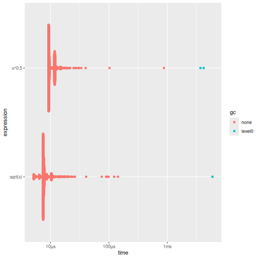

:::::::::::::::::::::::::::::::::::::: questions 

- What is microbenchmarking?
- How can the **bench** package be used to time R code?
- How can I visualise and interpret the results of microbenchmarking?

::::::::::::::::::::::::::::::::::::::::::::::::

::::::::::::::::::::::::::::::::::::: objectives

- Explain why it is important to benchmark code 
- Use **bench** to measure the execution time of different R expressions that produce the same result 
- Interpret the tabular and plotted output of `bench::mark()` and identify the fastest option.

::::::::::::::::::::::::::::::::::::::::::::::::

## Introduction

Microbenchmarking measures the performance of a very small piece of code, 
typically something that might take milliseconds (ms), microseconds (μs) or nanoseconds (ns), where, if a microbenchmark takes:

- 1 ms, then one thousand calls take a second.
- 1 µs, then one million calls take a second.
- 1 ns, then one billion calls take a second.

In R, the package [**bench**](https://bench.r-lib.org/) uses a high precision timer, making it possible to compare the speed of operations that run extremely quickly.

## Using the bench package

### `bench::mark()`

We can use the `bench::mark()` function to compare approaches to solving the same problem, e.g. finding the square roots of a vector of numbers:


``` r
x <- runif(1000)
sqrt_bench <- bench::mark(
  sqrt(x),
  x ^ 0.5
)

sqrt_bench
```

``` output
# A tibble: 2 × 6
  expression      min   median `itr/sec` mem_alloc `gc/sec`
  <bch:expr> <bch:tm> <bch:tm>     <dbl> <bch:byt>    <dbl>
1 sqrt(x)      5.16µs   7.57µs   126982.    7.86KB     12.7
2 x^0.5        9.27µs   9.36µs    95846.    7.86KB     19.2
```

By default, `bench::mark()` runs each expression enough times to take 0.5 seconds. It also checks that each run returns the same value. 

`bench::mark()` returns results as a tibble, with one row per expression. Although the print version of `sqrt_bench` above only shows 6 columns, there are in fact 13:


``` r
colnames(sqrt_bench)
```

``` output
 [1] "expression" "min"        "median"     "itr/sec"    "mem_alloc" 
 [6] "gc/sec"     "n_itr"      "n_gc"       "total_time" "result"    
[11] "memory"     "time"       "gc"        
```

- To compare time taken, the `min`, `median` and `itr/sec` (estimated number of executions performed per second) summarise the time taken by the expression, `n_itr` gives number of iterations and `total_time` gives the total time to perform the benchmarks. 
- To compare memory usage, `mem_alloc` is the total amount of memory allocated by R while running the expression, `n_gc` gives the total number of garbage collections and `gc/sec` give the number per second. 
- `result`, `memory`, `time` and `gc` are list-columns that store the underlying raw data.


We can visualise the distribution of the individual timings with `plot()`:


``` r
plot(sqrt_bench) # requires ggplot2, tidyr and ggbeeswarm to be installed 
```




:::::: discussion

## Useful columns

Which columns in the output of `bench::mark()` do you think are most useful in determining the best-performing expression? Why?

::::::

::::::::::::::::::::::::::::::::::::: challenge 


## Challenge 1

Here are two other ways to compute the square root of a vector. Of these along with the two methods already seen, how do you think they'll rank on speed? Use microbenchmarking to check your intuition.

```
x ^ (1/2)
exp(log(x) / 2)
```

:::: solution

``` r
bm <- bench::mark(
  sqrt(x),
  x ^ 0.5,
  x ^ (1 / 2),
  exp(log(x) / 2)
)

bm[order(bm$median), ]
```

``` output
# A tibble: 4 × 6
  expression         min   median `itr/sec` mem_alloc `gc/sec`
  <bch:expr>    <bch:tm> <bch:tm>     <dbl> <bch:byt>    <dbl>
1 sqrt(x)         5.17µs   5.22µs   168266.    7.86KB     67.3
2 exp(log(x)/2)   6.81µs   7.81µs   118687.    7.86KB     35.6
3 x^0.5           9.27µs   9.32µs   100372.    7.86KB     30.1
4 x^(1/2)         9.34µs   9.52µs    96105.    7.86KB     28.8
```
::::


:::::::::::::::::::::::::::::::::

::: callout
If the code is more than a single expression, create function wrappers for each alternative (the functions can also take arguments):

```
fun1 <- function() {
  # some code
}

fun2 <- function() {
  # some other code
}

bench::mark(fun1(), fun2())
```
:::


### Scaling and `bench::press()`

Benchmarking can be difficult as the best option can depend on the size of the data, e.g. memory allocation can overshadow run time for small objects.

When thinking about how our code scales to bigger, we need to consider what we mean by "big"

- number of rows or number of columns?
- number of observations or number of factor levels?

`bench::press()` compares a function over a grid of parameters.
The parameters you want to set are given as named arguments and a grid of all possible combinations is automatically created. 
The code to benchmark is then given by one unnamed expression


``` r
bp <- bench::press(
  n = c(10, 100, 1000), 
  k = c(100, 10, 1),
  bench::mark(gl(n, k)), # gl creates a factor with repeated levels
  .quiet = TRUE # don't print progress messages
)

bp
```

``` output
# A tibble: 9 × 8
  expression     n     k      min   median `itr/sec` mem_alloc `gc/sec`
  <bch:expr> <dbl> <dbl> <bch:tm> <bch:tm>     <dbl> <bch:byt>    <dbl>
1 gl(n, k)      10   100   6.07µs   7.26µs   134823.   15.93KB     40.5
2 gl(n, k)     100   100  40.49µs   45.1µs    20413.   81.36KB     45.5
3 gl(n, k)    1000   100 414.68µs 456.86µs     1978.  809.06KB     46.8
4 gl(n, k)      10    10   2.46µs   2.96µs   328545.      896B      0  
5 gl(n, k)     100    10   8.95µs   9.88µs    99010.   11.05KB     29.7
6 gl(n, k)    1000    10   94.8µs 101.39µs     9727.  105.94KB     28.0
7 gl(n, k)      10     1   2.08µs   2.55µs   376214.        0B     37.6
8 gl(n, k)     100     1   5.54µs    6.2µs   155280.    4.02KB     15.5
9 gl(n, k)    1000     1  63.66µs  65.49µs    14886.   35.62KB     14.7
```

::::::: challenge
## Challenge 2

`gl(n, k)` generates a factor by specifying the pattern of its levels, where `n` is the number of levels and `k` is the number of replications, e.g.


``` r
gl(2, 3)
```

``` output
[1] 1 1 1 2 2 2
Levels: 1 2
```

Looking at `bp` created above, increasing which of `n` or `k` has the biggest impact on the performance of `gl()`?

::: hint
You can rearrange the order of the rows (e.g. by `n` or `k` or `median`) to see patterns a different way.
:::


::: solution
Increasing `n` has the biggest impact. An order of magnitude increase in `n` for a fixed `k` leads to an order of magnitude increase in time.
:::
:::::::

::::::::::::::::::::::::::::::::::::: keypoints 

- Microbenchmarking is the most accurate way to compare the execution time of different R expressions that produce the same result
- **bench** is a powerful package for microbenchmarking R code
- Use `bench::mark()` to compare the performance of different expressions
- Use `bench::press()` to compare the performance of the same expression over a grid of different parameters

::::::::::::::::::::::::::::::::::::::::::::::::

